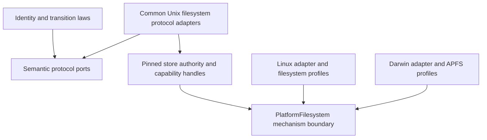

# Filesystem platform adapters

Status: implementation design. The checked-in Linux adapter remains the only
production-admitted backend until the acceptance gates below have evidence.

This design adds native macOS storage while retaining Keep's exact-byte,
exclusive-writer, immutable-publication, and recovery contracts. It also defines
the boundary for admitting additional Linux filesystems without copying every
storage protocol. Windows and network filesystems are outside this work.

## The boundary to introduce

Keep has several storage **capabilities**, not four competing storage engines.
Initialization, catalog publication, retention publication, and migration each
need a different subset of operations and a different authority state. Keep
those focused ports. Implement them over one admitted filesystem session.

The diagram's arrows mean dependency or implementation, not execution order.
The protocol orchestrator calls its semantic port; the common Unix adapter
implements that port using the selected platform implementation.

The two boundaries have different purposes:

| Boundary | Owns | Must not own |
| --- | --- | --- |
| Semantic protocol ports | Required effects, ordering obligations, typed outcomes | OS selection, descriptors, filesystem detection |
| Common filesystem adapters | Canonical namespace, pinned authority, exact verification, protocol effects | Linux or Darwin syscall policy |
| `PlatformFilesystem` | Root traversal, descriptor observations, durability, native locking semantics | Catalog generations, retention policy, codecs, recovery decisions |
| Filesystem profile admission | Which observed configurations satisfy the supported contract | Caller-selected claims of safety, best-effort fallback |

The platform boundary is an internal infrastructure interface, not a domain
port pretending that POSIX descriptors are domain objects. Descriptor types
and capability-library types stay on the infrastructure side. Domain ports
continue to exchange semantic values. Existing codec-bearing protocol ports
are not a precedent for moving filesystem types into the domain.

## Why a factory is not the main abstraction

A factory can choose an implementation, but returning four unrelated objects
would let their locks, root handles, filesystem observations, or recovery state
diverge. It would also duplicate the operating-system work in four adapters.

Use one admitted root and retained writer authority as the construction root.
An initialization or reopen operation establishes that authority; subsequent
protocol adapters consume it or borrow it exclusively. Migration changes the
permitted session state. It does not mint another independent writer.

Keep's existing `FilesystemPlatformAdmission` and version-two admission values
already establish much of this ownership discipline. Preserve those public
entry points during the implementation. A convenience `FilesystemStore` facade
is justified only if it removes repeated consumer orchestration; it must not
be required merely to select Linux versus macOS.

Backend selection occurs once through a native-platform alias. Adding a new
OS requires a platform implementation, its selection entry, and conformance
evidence. It must not require another catalog, retention, migration, or
recovery state machine. Adding another filesystem on the same OS ordinarily
requires a profile and its evidence, not another implementation of every port.

## Platform interface

The implementation separates shared profile admission from native observations.
The interface has these semantic responsibilities; final Rust names may be
refined without changing the contract:

| Operation | Required result |
| --- | --- |
| Open a selected root | Pinned readable directory, no symlink traversal |
| Observe a directory | Filesystem kind, writable/local observations, naming behavior, device/mount/object coordinates |
| Observe an existing object | Exact descriptor-bound identity; no path reopening as a substitute |
| Synchronize a regular file | All prior writes reach the platform's documented durable boundary, or an exact error |
| Synchronize a directory | Prior namespace effects reach that boundary, or an exact error |
| Acquire a native lock | Nonblocking kernel exclusion tied to the retained handle; typed contention |
| Validate entry spelling where necessary | The actual namespace entry has the exact protocol spelling |

Use concrete observation records, checked constructors, and explicit enums for
naming and mount behavior. No `supports_durability: bool` supplied by a caller,
no catch-all string capability map, and no public boolean parameters.

Common code owns the protocol-directory list, checks every existing child,
and compares its device and mount with the root. Native implementations own
the evidence producers, not the decision to skip a required check. Required
but unreported properties are refusal, not a default value.

Do not add a trait for every POSIX operation. `cap-std` already provides shared
capability-relative file access, hard links, renames, and directory iteration.
Keep a common Unix implementation for those operations and introduce a native
hook only where semantics differ. No dynamic dispatch, per-operation heap
allocation, or reference-counted writer authority is needed for OS selection.

## Admission and continued authority

Admission is ordered as follows:

1. Pin the root through a no-follow traversal.
2. Observe its supported filesystem profile and every existing protocol child.
3. Refuse unrecognized names, wrong kinds, foreign mounts, and unsupported
   naming behavior before creating protocol artifacts.
4. Acquire root and writer-file exclusion, retaining the exact descriptors.
5. Revalidate the namespace and identities under writer authority.
6. Execute initialization, publication, or explicit recovery in existing order.
7. Return success only after all required synchronization succeeds.

Subsequent protocol admission must not revert to ambient path lookup. Newly
created children are verified through retained parent capabilities before use.
Existing substitution and uncertain-recovery refusals remain mandatory.

An adapter's successful admission does not prove that the operator has not
shared a block device with another host, or that hardware honestly implements
flush commands. Local exclusive administration remains a deployment condition.
There is no claim of exclusion against arbitrary uncooperative mutation.

## Linux profiles

The first implementation preserves existing ext4 behavior: writable,
non-casefolded directories, no symlink traversal, and one device/mount across
the protocol namespace. `openat2` and `statx` remain native implementation
details. Missing required `STATX_MNT_ID` continues to refuse in production.

Do not promote every filesystem with a working `fsync` to supported status.

| Candidate | Design treatment | Admission requirement |
| --- | --- | --- |
| ext4 | Preserve current profile | Existing laws plus adapter-equivalence regression evidence |
| XFS | First additional Linux candidate | Separate profile, real mounted-filesystem publication/recovery and sync evidence |
| Btrfs | Separate candidate | Subvolume identity, rename/link restrictions, and durability evidence |
| tmpfs | Test-only, not durable storage | Never admitted merely because synchronization returns success |
| OverlayFS | Not admitted by this change | Copy-up identity and backing-filesystem semantics require a distinct contract |
| NFS, SMB, FUSE, unknown types | Refuse | A future explicit contract and evidence, not a permissive fallback |

XFS and Btrfs consideration is part of this design; enabling them without
their evidence is not part of native macOS acceptance. The interface must
allow adding either without editing the protocol orchestrators.

## macOS profiles

The intended native target is local writable APFS, including the ordinary
case-insensitive variant and case-sensitive APFS. HFS+ and other filesystems
remain explicit future profiles. APFS snapshots and read-only mounts refuse
writer admission.

Root traversal uses descriptor-relative, no-follow component opens. Handle
identity uses Darwin observations; it must not pretend that device identity
is independently observed mount identity. Symbolic links in the selected path
remain a refusal. The documentation must explain that `/tmp` on macOS is a
symlink and use the actual selected directory instead of silently resolving it.

Case-insensitive APFS needs an explicit naming contract. Keep-generated names
are canonical ASCII; their grammar must be injective under APFS name matching.
The actual names observed during namespace admission must match the grammar
byte-for-byte. `HEAD` must not be admitted through a foreign `head` entry,
and uppercase digest names must not silently alias canonical lowercase names.
The same obligation applies to reads, recovery, and publication reuse, not
only to store initialization. Implement and test exact-spelling checks before
admitting this profile. Unicode normalization is irrelevant to generated names
but must not turn malformed foreign names into admitted protocol entries.

Regular-file synchronization preserves the pinned Rust toolchain's full-flush
semantics. Rust 1.96's Apple `File::sync_all` calls `F_FULLFSYNC`. Directory
synchronization requires native validation of the same guarantee; do not
catch `EINVAL` or `ENOTSUP` and return success, and do not silently substitute
plain `fsync` for a stronger promised operation.

The native adapter must use safe existing wrappers where available. If a
required descriptor-bound observation has no safe wrapper, isolate the minimal
FFI in a dedicated crate with documented invariants and boundary tests. Adding
a broad platform dependency merely for one syscall is not the default choice.

## Physical coordinates and durable compatibility

Content identities, canonical segment/catalog bytes, and storage profiles do
not depend on the OS. Existing Linux bytes and golden fixtures remain stable.

Physical recovery coordinates are separate from logical content identity.
The current migration record stores device, mount, and file coordinates as
three big-endian `u64` values. Current main treats mount identity as live
same-process evidence and compares device/inode for restart. Preserve that
distinction; never replace a persisted intent merely because a mount number
changed after restart.

Document a named Darwin coordinate mapping and its validation before emitting
such records. It must be deterministic, checked, and must reject copied roots.
Do not hash arbitrary OS structs or truncate native fields. If the existing
wire grammar cannot distinguish a necessary coordinate domain, make a
versioned format decision rather than silently reinterpreting existing bytes.

Cross-OS movement of a physical store is not ordinary reopen. A store whose
recovery evidence binds it to another physical root must refuse. Logical
content export/import remains independent of those coordinates.

## Failure model

The platform adapter cannot skip or combine named durability phases. An I/O
failure retains its source and protocol phase, and no success receipt is
created. Dropping an adapter releases resources; it does not commit or repair.

Publication retains the existing forward ordering and immutable artifacts.
Every interrupted prefix must reopen to the documented snapshot or explicit
recovery/refusal. Failure during recovery remains uncertain until re-observed.
Unknown filesystems, absent observation fields, wrong kinds, alias spellings,
foreign mounts, failed flushes, and contested locks all refuse.

The existing deterministic process-death harness is reusable, but a harness
that bypasses production platform admission cannot establish native support.
Native acceptance must enter through the ordinary public production path.
Process death is not a physical power-loss experiment.

## Implementation and acceptance

The work proceeds through independently working checkpoints, without enabling
an unfinished backend in production:

1. Extract native mechanism observation and shared admission policy while
   preserving Linux acceptance and every public signature.
2. Route OS-dependent durability and authority operations through that boundary.
3. Implement Darwin observations and exact namespace semantics, with typed
   refusal tests and a bounded native test environment.
4. Admit APFS only after production initialization, publication, reopen, reads,
   lock exclusion, corruption refusal, and recovery tests pass natively.
5. Run Linux regression validation, native debug/release checks, formatting,
   strict Clippy, dependency policy, and documentation checks. Add repeatable
   macOS CI coverage with explicit supported filesystem profiles.

An independently useful new adapter must pass the same semantic conformance
laws. Test both success and the boundary failures: symlinked roots/children,
case aliases, missing fields, read-only mounts, foreign devices/mounts,
replaced lock files, copied roots, failed file/directory synchronization, and
each affected crash/recovery prefix. Calibrate refusal assertions against
deliberately weakened evidence, separately from product execution results.

Build output is bounded within the aggregate 20 GiB Keep budget. Test stores,
scratch data, and logs share the separate 4 GiB budget, including a 128 MiB log
ceiling. Use one serialized reusable cache per incompatible OS toolchain;
native validation cannot reuse Linux object files. Every launch records actual
usage, free space, lock, enforced limits, timeout, and descendant cleanup.

The implementation is complete only when the design is reflected in code,
Linux behavior remains verified, native production APFS paths are exercised,
and copies of this design and its decision record have intact Reader receipts.

## Sources and related contracts

- [Hexagonal boundaries](https://github.com/flyingrobots/keep/blob/3887f2a/docs/adr/0004-hexagonal-boundary-architecture.md).
- [Platform adapter decision](../adr/0010-filesystem-platform-adapters.md).
- [Current filesystem contract](https://github.com/flyingrobots/keep/blob/3887f2a/docs/formats/segment-store-v1/recovery.md#platform-contract).
- [Migration recovery](https://github.com/flyingrobots/keep/blob/3887f2a/docs/formats/segment-store-v2/migration-recovery.md).
- [Apple APFS naming variants](https://developer.apple.com/library/archive/documentation/FileManagement/Conceptual/APFS_Guide/FAQ/FAQ.html).
- [Apple file synchronization](https://developer.apple.com/library/archive/documentation/System/Conceptual/ManPages_iPhoneOS/man2/fsync.2.html).
- [Apple descriptor controls](https://developer.apple.com/library/archive/documentation/System/Conceptual/ManPages_iPhoneOS/man2/fcntl.2.html).
- [Linux ext4 format documentation](https://www.kernel.org/doc/html/latest/filesystems/ext4/index.html).

Apple's archived manual pages describe the syscall contract; actual APFS
support still requires native execution evidence on the recorded OS version.
